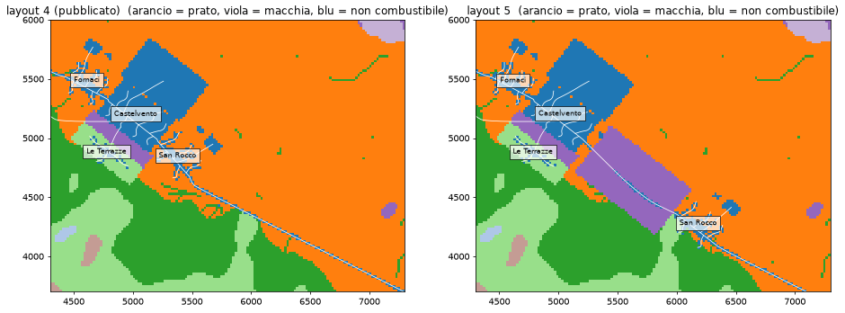

# Layout 5: San Rocco lontano, strada nella macchia (headless, 2026-10-11)

Decisione dell'utente: modificare il territorio perché evacuare tutti abbia un costo reale (`../uscite/README.md`), poi la caserma. **Non pubblicato**: il gioco usa ancora il layout 4.

**Cosa cambia** (`tools/factory/town.py`, `T4_L5`, solo dati; i layout 1–4 sono identici):
- San Rocco si sposta di 1 km lungo la SP 12, ai piedi del versante boscoso. Va a Castelvento per una sola strada, poi lungo la via principale fino al rifugio;
- fra i due paesi, terrazze abbandonate a macchia (classe 8) su 870 × 500 m;
- in quel tratto la SP 12 resta nella vegetazione (`Layout.verges`). La cella di 20 m dipinta come non combustibile la rendeva intransitabile per il fuoco: nessuna fiamma arrivava a un'auto, qualunque cosa bruciasse accanto (`fire::threat`, pericolo sempre < 0,55).



**Riproduzione:**

```
.venv/bin/python tools/scenario_factory.py build-town --layout 5
.venv/bin/python tools/scenario_factory.py verify --scenario t4_paese5        # 10 OK
.venv/bin/python tools/scenario_factory.py town-fires --scenario t4_paese5
.venv/bin/python tools/scenario_factory.py game-cases --scenario t4_paese5
sh docs/fase5/layout5/installa_l5.sh    # cartella dati di prova, con il layout 5 come rocca_ventosa
cd <cartella>/l5 && PRIORITA="San Rocco" <repo>/target/release/examples/intasamento Rocco2 Borgo2_gira Rocco3 --semi 1,2,3
```

## Risultati

| | layout 4 | layout 5 |
|---|---|---|
| strada di San Rocco tagliata dal fuoco | T+41 (Borgo2), solo nel borgo | **T+42–60** in 5 casi, sul tratto verso Castelvento |
| quanto costa evacuare tardi (Rocco2, seme 1, T+0 → T+30) | Borgo2: 0 punti | **692 → 392** |
| famiglie colte in strada | 0 | **0** |
| calore massimo su un'auto (letale 90 s) | 15 s | 6 s |
| effetto dell'evacuazione di Castelvento su San Rocco | nessuno | **nessuno** |
| caserma all'ingresso nord-ovest della SP 12 | — | primo mezzo 1–3 min più tardi, **uguale con ogni piano civile** |

(`uscita_condivisa.md`, `caserma_dentro.md`, `caserma_fuori.md`, `uscite_tutti_i_casi.md`)

1. **Il ritardo ora costa davvero**: la strada di San Rocco brucia nella finestra T+40–60.
2. **La coda non arriva sul tratto esposto.** Le 100 famiglie di San Rocco non saturano la SP 12 (1400 auto/ora). La coda di Castelvento, fino a 182 auto, resta dentro il paese. Le auto ricalcolano il percorso ogni 60 s e una cella è pericolosa solo mentre brucia: nessuna famiglia viene travolta.
3. **La caserma fuori non cambia nulla.** I mezzi partono a T+0 e arrivano prima dell'ondata: in 9 confronti su 9 i punteggi sono uguali o quasi.
4. **Risultato nuovo: la preallerta da sola batte «evacua tutti a T+0» in 9 confronti su 9**, di 40–250 punti (Rocco2, seme 1: 832 contro 692).

## Perché la preallerta vince: asimmetria nel modello dei comportamenti

Rocco2, seme 1, solo San Rocco. Con **evacua** a T+0, 10 famiglie sono colte in casa. Sette sono «aspetta e vedi», con 10–16 minuti di preparazione, e partono solo fra T+40 e T+58, quando il fuoco è già sulla porta. Con la **preallerta** le stesse sette famiglie partono prima che arrivi: le colte sono 3. Nel codice `readied_s` (preparazione anticipata) cresce solo per chi ha ricevuto la preallerta (`crates/abm/src/lib.rs:1368`). Una famiglia che riceve l'ordine ma aspetta di vedere il fuoco non si è preparata, e quando decide di partire deve ancora fare tutta la preparazione. **Da verificare con l'utente:** è voluto (l'ordine si ignora, l'avviso fa preparare) o un ordine dovrebbe almeno far preparare come una preallerta?

## Incognite

- I livelli vanno riscelti: con gli inneschi nuovi `Forna3`/`Forna3_gira` (Medio) bruciano 1 ha, `Rocco3` cambia.
- Tutto con la priorità «San Rocco»; il coordinatore e i mezzi non sono stati ottimizzati per il layout 5.
- Che una famiglia venga travolta in auto è raro per costruzione: il calore si accumula solo a contatto con la fiamma (pericolo ≥ 0,55). È plausibile, ma limita il costo che si cercava.

## Proposta (una)

Non pubblicare il layout 5 per ora. Prima decidere il punto sull'asimmetria ordine/preallerta. Se un ordine deve far preparare almeno quanto una preallerta, «evacua subito» torna a dominare e la coda resta senza costo. Se invece resta così, nel layout 5 la scelta fra avvisare e ordinare ha già conseguenze misurabili.
