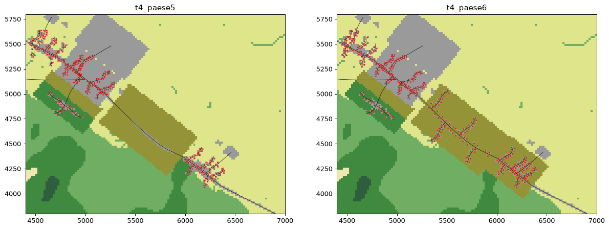

# Fumo sulle strade e layout 6, paese sparso (headless, 2026-10-11)

Decisioni dell'utente (2026-10-11): niente aree di attesa fuori dai centri («irrealistico per la protezione civile»). Al loro posto, vegetazione più vicina al paese o un paese più sparso. Sì al fumo che rallenta il traffico. **Non pubblicato**: il gioco usa ancora il layout 4.

**Cosa cambia:**
- `crates/abm/src/traffic.rs` (`smoke_flow`, `SMOKE_FLOW_FLOOR`) e `lib.rs`: un tratto con fumo o fiamma ai lati lascia passare meno auto al minuto.
  - Sotto `ALARMING` (0,12) nulla cambia; da lì la portata cala in linea fino al 20 % a `IMPASSABLE` (0,55).
  - Si aggiunge alla velocità ridotta all'ingresso, che c'era già. È un'ipotesi, non una misura.
- `tools/factory/town.py`, `T4_L6` (solo dati), che parte dal layout 5:
  - Castelvento si allunga lungo la SP 12 verso San Rocco con case sparse e stradine nella macchia: 230 famiglie invece di 190;
  - San Rocco perde il nucleo incombustibile;
  - la SP 12 resta nella macchia lungo tutto il suo tracciato fra i due paesi (`Layout.wooded_roads`). La fascia del layout 5 mancava la curva, dove la strada si scosta di 60 m dall'asse.



**Riproduzione:**

```
.venv/bin/python tools/scenario_factory.py build-town --layout 6     # poi verify (10 OK), town-fires, game-cases
DEST=<cartella> SCEN=t4_paese6 SUB=l6 sh docs/fase5/layout5/installa_l5.sh
cd <cartella>/l6 && <repo>/target/release/examples/strategie_civili > strategie.md
```

`strategie_civili` usa tutti i 36 incendi, seme 1. Per ogni incendio:
- «minacciati» sono i quartieri che lo stesso incendio senza ordini raggiunge, cioè col senno di poi;
- le priorità dei mezzi sono quei quartieri;
- cambia solo il piano civile.

## Risultati

| | layout 4 | layout 5 | layout 6 |
|---|---|---|---|
| incendi che colpiscono qualcuno | 29 | 26 | 28 |
| piano migliore | evacua tutti 18, preallerta tutti 11 | 16 / 9 | 14 / 12 |
| «evacua tutti» peggio di «evacua i minacciati» (> 20 punti) | **0** | **0** | **0** |
| famiglie colte fuori casa (tutti i piani) | 0 | 1 | **0** |
| calore massimo su un'auto (letale 90 s) | 3 s | 6 s | 20 s |
| auto ferme su tratti pieni, massimo | 34 | 38 | 32 |
| punti medi: evacua tutti / evacua i minacciati / preallerta tutti | 685 / 675 / 650 | 671 / 671 / 632 | 656 / 647 / 646 |

(`strategie_layout4.md`, `strategie_layout5.md`, `strategie_layout6.md`; il fumo sulla portata è attivo in tutte e tre.)

1. **Il fumo sulla portata non cambia nulla di misurabile.** Sul layout 5, nella prova di `../layout5/uscita_condivisa.md` (5 incendi, 3 semi, 180 partite), cambia solo il pericolo massimo su un'auto in 3 righe (0,26 → 0,25). Quando il fumo arriva sulla strada le auto sono già passate.
2. **Il paese sparso non crea code.** Le famiglie partono distribuite su 6–18 minuti di preparazione. Così anche 540 famiglie restano sotto la portata delle strade: al massimo 32 auto ferme in tutto il territorio. Il fuoco arriva sui paesi dopo 40 minuti o più, quando le strade sono vuote.
3. **Evacuare chi non è minacciato non costa nulla**, nemmeno nel layout 6. Le famiglie perse sono sempre quelle «aspetta e vedi» che restano a casa, con qualsiasi piano.

## Perché la fisica non basta

Con questi numeri, cioè sei quartieri, strade da 800–1400 auto/ora e un fronte che impiega più di 40 minuti, **il traffico non diventa mai il collo di bottiglia**. Un costo da coda richiederebbe migliaia di auto o un fronte che arriva in 10–15 minuti. Né il territorio né il propagatore danno queste condizioni senza forzature.

L'unica risorsa davvero limitata fra l'ordine e la partenza è **chi porta l'ordine**: oggi ogni famiglia lo riceve con un ritardo fisso, sorteggiato al momento della generazione (da 90 s a 20 minuti, `abm::comms`), indipendente da quanti quartieri si ordinano insieme.

## Incognite

- Il punteggio non conta le famiglie morte o intrappolate dopo essere partite (`rocca::score` usa solo le colte in casa). Oggi sono 0, ma vanno contate se un modello le produce.
- Resta aperta l'asimmetria fra ordine e preallerta nella preparazione (`../layout5/README.md`).
- Layout 6: livelli non riscelti, mezzi e coordinatore non rivisti.

## Proposta (una, da decidere: cambia il modello dei civili)

**Diffusione degli ordini con squadre limitate.**
- In Italia un ordine di evacuazione per incendio si porta casa per casa, con polizia locale, carabinieri, volontari e altoparlanti. Da verificare se IT-alert si usa per gli incendi boschivi.
- Alcune squadre di avviso, oltre ai mezzi antincendio: ogni quartiere ordinato riceve l'avviso a partire dal centro, a una velocità che dipende da quante squadre ci lavorano.
- Ordinare tutti divide le squadre, e il borgo minacciato riceve l'ordine più tardi.
- È un costo reale, già nel modello, e dipende dalle priorità del giocatore, non dal punteggio.

Prima una prova headless, senza toccare il gioco: ritardo di ricezione proporzionale al numero di quartieri ordinati insieme, su tutti gli incendi del layout 4.
