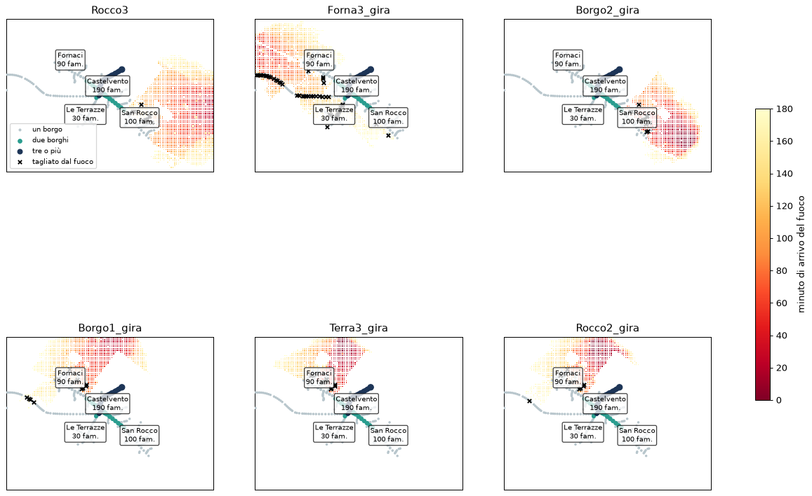

# La mappa delle uscite (headless, 2026-10-11)

Domanda: in quale incendio il fuoco taglia un'uscita in comune tra più borghi mentre le auto sono in coda? Seguito di `../intasamento/README.md`.

**Riproduzione:**

```
cargo run --release -p rocca --example uscite -- --csv <dir>          # 36 casi, seme 1 → tutti_i_casi.md
.venv/bin/python docs/fase5/uscite/mappa_uscite.py <dir> mappa.png 1500,7500,1500,6500 Rocco3 Forna3_gira ...
cargo run --release -p rocca --example uscita_condivisa -- [caso:borgo ...] --semi 1,2,3
```

## Dove vanno le auto

I rifugi sono scelti misurando la vegetazione intorno (`abm::refuge`). Su questo territorio ce ne sono due interni, **dentro i centri incombustibili**: Castelvento (combustibile nel raggio 1 %) e Pian dei Grilli (4 %). Le quattro uscite dalla mappa sono più lontane. I borghi del nord-est e Le Ghiande vanno a Castelvento, Pian dei Grilli resta nel proprio centro.

- **Il tratto in comune** (il tronco scuro in `nordest.png`, usato da 3–5 borghi) **sta tutto dentro Castelvento**, in una zona senza vegetazione (`combustibili_tronco.png`). Nessun incendio può tagliarlo.
- **Evacuare Castelvento** vuol dire fare 300 m in auto dentro il paese fino al rifugio: genera coda, ma non espone nessuno.
- **Il fuoco taglia solo strade di un solo borgo**, cioè i 300–500 m tra il borgo e Castelvento o la serpentina di Le Ghiande. In 36 casi nessun nodo in comune viene tagliato (`tutti_i_casi.md`).



## Anche dove il fuoco taglia presto

Casi in cui l'accesso di un borgo a Castelvento viene tagliato presto: Borgo2 e Borgo2_gira (San Rocco, T+41), Terra3 e Terra3_gira (Fornaci, T+50–60). Ordine di evacuazione a T+0/15/30/45 per il solo borgo, per tutti tranne Castelvento, per tutti. Semi 1–3:

- **colte fuori casa: 0** in tutte le partite;
- **calore massimo su un'auto: 15 s su 90 letali**, **identico** che Castelvento evacui o no: è un'auto in ritardo, non la coda;
- la coda di Castelvento (fino a 33 auto ferme) non trattiene le auto del borgo: gli esiti del borgo non cambiano.

Le auto ricalcolano il percorso ogni 60 s e girano intorno alle celle in fiamme. Il fuoco raggiunge l'accesso del borgo quando il borgo si è già svuotato.

## Conclusione

Con questi rifugi e queste strade la coda **non può** essere travolta. Una partenza anticipata è sempre almeno sicura quanto restare, perché il rifugio è vicino e incombustibile. Il costo di evacuare tutti non dipende da incendi o semi: dipende da **dove porta l'evacuazione**. Per cambiarlo bisogna modificare il territorio (fase 2), non il propagatore né il punteggio.

## Incognite

- La griglia dei borghi (il tratto in comune è nei nodi della rete) e i 60 s di ricalcolo dei percorsi non sono stati variati.
- L'ordine di evacuazione di Castelvento porta comunque al rifugio di Castelvento: nel gioco è un ordine senza effetto fisico, salvo la coda.

## Proposta (una, da decidere: è una modifica del territorio)

**Aree di attesa designate fuori dai centri.** Per esempio un'area sulla strada verso la SP 12 a sud-est, raggiungibile solo da una strada lunga che attraversa la vegetazione, mentre i centri incombustibili servono per restare al riparo. Così:

- evacuare Castelvento senza motivo manda 190 famiglie su quella strada e la intasa per San Rocco;
- un incendio da est può raggiungere la colonna, il costo implicito che ti interessa;
- la preallerta acquista senso: restare pronti in un centro sicuro e partire solo se serve.

Prima di toccare il territorio, una prova headless a parità di semi con l'insieme dei rifugi modificato (centri esclusi come destinazione dell'evacuazione) per vedere se il costo compare davvero.
